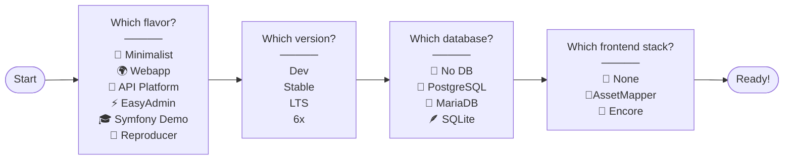

# Symfony Starter

Generate a fully Dockerized Symfony application with a single command 🥳

From a minimal [Symfony](https://symfony.com/) skeleton to a full [API Platform](https://api-platform.com/) or [EasyAdmin](https://github.com/EasyCorp/EasyAdminBundle) stack, [Symfony Starter](https://github.com/jprivet-dev/symfony-starter) handles the entire setup — Docker, database, dependencies — so you can focus on your code from the first minute. You can also use the official [Symfony Demo](https://github.com/symfony/demo) as a reference for best practices, or [contribute to Symfony Core](contrib.md) in a real Docker environment.

Built on top of [dunglas/symfony-docker](https://github.com/dunglas/symfony-docker) and driven by a powerful Makefile, it covers everything from project initialization to daily development.



## Prerequisites

Be sure to install the latest version of [Docker Engine](https://docs.docker.com/engine/install/).

## Installation

### 1. Clone the project

```shell
git clone git@github.com:jprivet-dev/symfony-starter.git
cd symfony-starter
```

### 2. Generate your app

* [Generate your Symfony project](.starter/docs/README.md).
* [Generate your reproducer and contribute to Symfony](.starter/docs/contrib/contrib.md) — see [existing reproducers](https://github.com/jprivet-dev/symfony-starter/branches/all?query=reproducer%2F).

### 3. Go on the app

Go to https://symfony-starter.localhost:8442/ and accept [the auto-generated TLS certificate](https://stackoverflow.com/a/15076602/1352334) on first visit.

## Documentation

* 📖 [The Project documentation](docs/README.md).
* 🚀 [The Symfony Starter documentation](.starter/docs/README.md).

## Comments, suggestions?

Feel free to make comments/suggestions in the [Git issues section](https://github.com/jprivet-dev/symfony-starter/issues).

## License

This project is released under the [**MIT License**](https://github.com/jprivet-dev/symfony-starter/blob/main/LICENSE).
